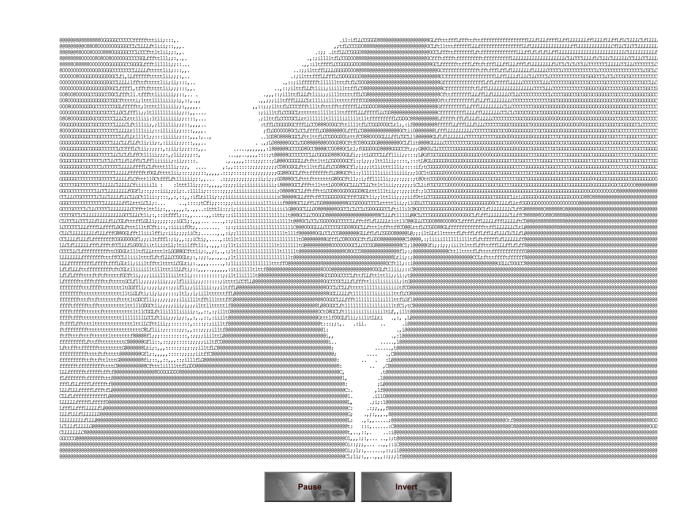
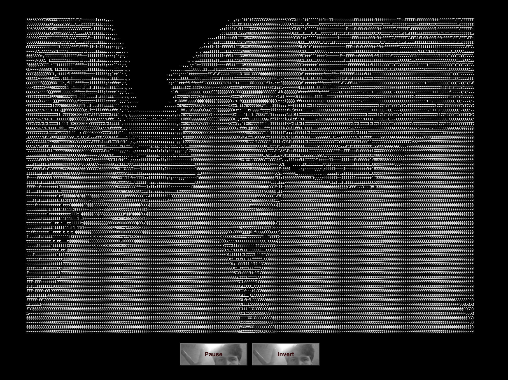

# AsciiVision: Interactive ASCII Art Generator
AsciiVision is a creative coding project that merges human-computer interaction with artistic expression. It turns light into letters: your camera, rendered live as ASCII art, in a page that starts by itself, introduces itself, and adapts to whatever screen it is on.

<p align="center">
  
</p>
<p align="center">
  Ascii image in black and white.
</p>


## What happens when you open it
Nobody has to click anything.

1. **It starts on its own.** From the first frame a generative animation is running: a plasma that the name *AsciiVision* rises out of.
2. **It introduces itself.** A narrator types out a short introduction as captions, and speaks it aloud where the browser allows (see [About the voice](#about-the-voice)).
3. **It asks for your camera**, right on cue, and crossfades from the animation into your live picture.
4. **If there is no camera** (you said no, there isn't one, another app has it, or the page isn't on https) it explains why, and keeps the show going: a spinning donut, digital rain, lava blobs. They react to your finger or mouse.

Come back later and it greets you with a shorter hello and goes straight to the camera.

## Features
- **Real-time ASCII art** from your webcam, with automatic exposure so it looks good in a dim room and a sunny one.
- **Five themes:** phosphor green, ink, paper (dark ink on a pale page, like a print), amber terminal and full colour, where every letter takes the colour of what the camera sees.
- **Four character sets:** classic (the original), dense (70 levels), blocks and binary.
- **Motion shimmer:** parts of the picture that move glow a little brighter.
- **Snapshots** with a small watermark: the share sheet on phones, a download everywhere else.
- **Front and rear camera** switching on devices that have both.
- **Controls that get out of your way:** they fade after a few seconds and come back when you move the mouse or tap.

## Controls
| | Touch | Keyboard |
|---|---|---|
| Show / hide the controls | tap | move the mouse, or `H` |
| Pause / resume | Pause button | `Space` or `P` |
| Camera on / off | Camera button | `C` |
| Next theme | Theme button, or swipe left / right | `T` |
| Next character set | Glyphs button | `G` |
| Front / rear camera | Flip button | `R` |
| Save a picture | Snap button | `S` |
| Voice on / off | Voice button | `V` |
| Fullscreen (where supported) | Fullscreen button | `F` |
| Next demo scene | | `D` |

Your theme, character set and voice choice are remembered between visits.

## Works on every screen
AsciiVision looks at the device and adapts:

- **Phone, tablet or desktop** is detected (including iPadOS, which pretends to be a Mac) and picks the letter size: small and sharp on a phone, larger on 4K desktops. Rotating the device or resizing the window rebuilds the grid.
- **Camera video fills the screen** without stretching, in portrait and landscape. Selfie cameras are mirrored, rear cameras are not.
- **Notches and home indicators** are respected, and the controls stay clear of them. The interface is full-screen with no scrolling or bounce.
- **Performance adapts:** the frame rate and pixel density are chosen from the device's capabilities, and if frames still take too long the letters get a little bigger and fewer until it runs smoothly.
- **Battery friendly:** it pauses when the tab is hidden and lets go of the camera when you leave the page. If the system takes the camera away (iOS does this in the background) it asks for it back.
- **Accessible:** real buttons with labels, keyboard control, screen-reader announcements for the narration, and reduced motion is respected (no typewriter effect, slower scenes, no flash).

## About the voice
Browsers will not play sound, including speech, on a page that nobody has touched yet. So the captions always appear, and the voice starts as soon as the visitor taps, clicks or presses a key anywhere on the page. Until then a small "Tap for voice" bubble is shown. The camera permission prompt works the same way: the browser always asks first, and no website can skip that.

## URL options
Handy for testing, or for linking to a specific look:

| Option | Example | Effect |
|---|---|---|
| `theme` | `?theme=amber` | `phosphor`, `ink`, `paper`, `amber` or `color` |
| `glyphs` | `?glyphs=blocks` | `classic`, `dense`, `blocks` or `binary` |
| `scene` | `?scene=donut` | start on `plasma`, `donut`, `rain` or `lava` |
| `camera=off` | `?camera=off` | never ask for the camera |
| `intro=off` | `?intro=off` | skip the introduction |
| `voice=off` | `?voice=off` | start muted |
| `debug` | `?debug` | show frame rate and grid size |
| `fixed` | `?fixed` | turn off automatic quality adjustment |

## How It Works
The picture, from the camera or from a generative scene, is always reduced to one brightness number per letter cell. `ascii.js` maps each number to a character from the chosen set, and draws whole rows of text per frame, which keeps it fast.

| File | Job |
|---|---|
| `script/app.js` | the conductor: render loop, controls, gestures, the self-running intro |
| `script/device.js` | detects phone / tablet / desktop, screen density and performance tier |
| `script/camera.js` | the live video (modern `mediaDevices` API, front/rear, error explanations) |
| `script/ascii.js` | brightness to letters, auto-exposure, colour, glow, snapshots |
| `script/scenes.js` | the generative scenes and the title |
| `script/narrator.js` | typed captions and speech |

There is no build step and no dependencies. It is plain HTML, CSS and JavaScript, so any static host works.

## Running it locally
Camera access only works on `https://` pages and on `localhost`, so serve the folder rather than opening the file directly (opening `index.html` still shows the animations):

```
python3 -m http.server 8000
```

then open <http://localhost:8000>.

## Supported browsers
Any current Chrome, Edge, Firefox or Safari, on desktop, Android, iPhone and iPad. Without camera support the generative show still runs.

## Credits
AsciiVision is the brainchild of Jonas Kjeldmand Jensen, conceived as a fusion of creative coding, human-computer interaction, and interaction design principles. `camera.js` descends from the library of the same name by Andrei Gheorghe (MIT), and the spinning donut is a tribute to Andy Sloane's classic.

## License
AsciiVision is licensed under the MIT License.

## Get Involved
Join the creative coding community and contribute to AsciiVision by forking the repository on [GitHub](https://github.com/QC20/AsciiVision). Whether you're interested in enhancing functionality, refining user interface elements, or exploring new artistic possibilities, your contributions are welcomed and appreciated.

<p align="center">
  
</p>
<p align="center">
  Ascii image in white and black.
</p>

**Ideas:**
- [ ] Install as a home-screen app (web app manifest and offline support)
- [ ] More scenes: starfield, fluid, fire
- [ ] Record a few seconds as a looping GIF
